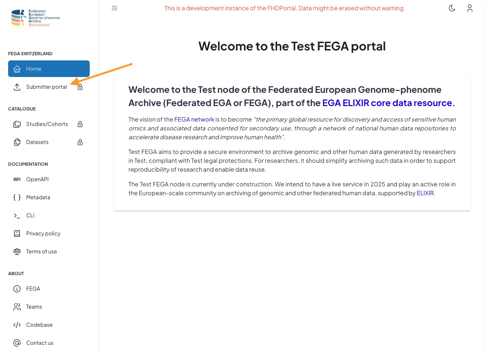
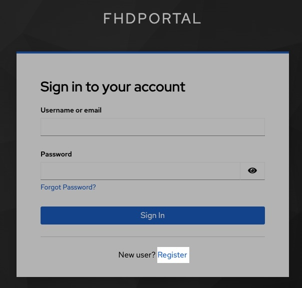
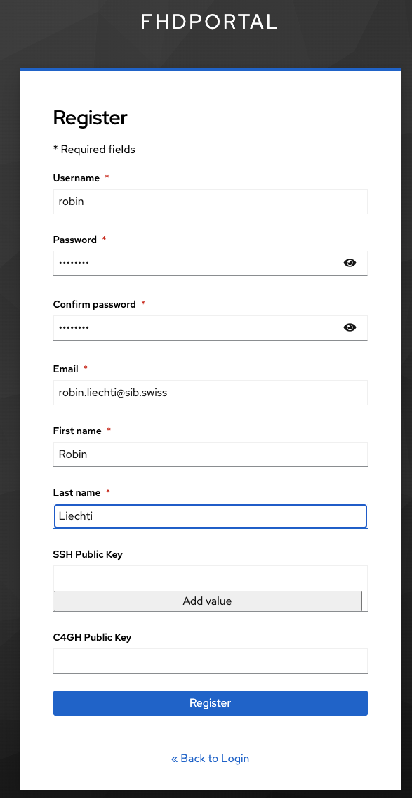
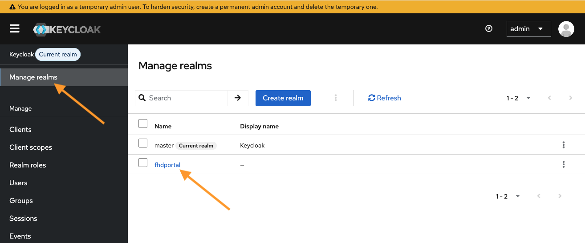
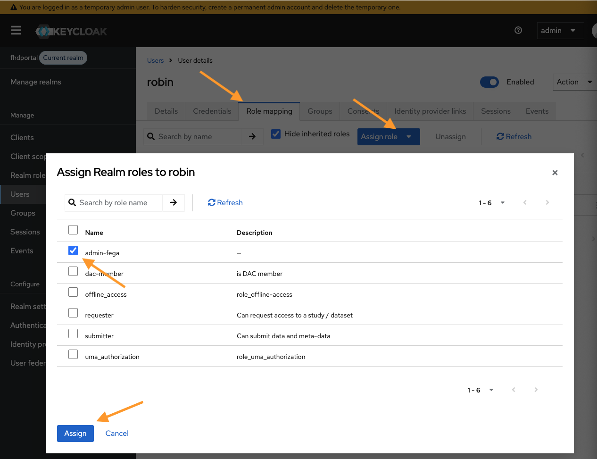
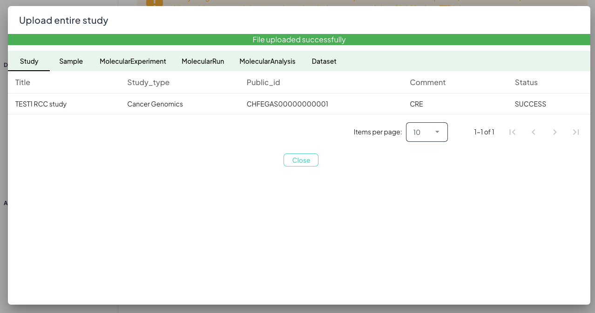
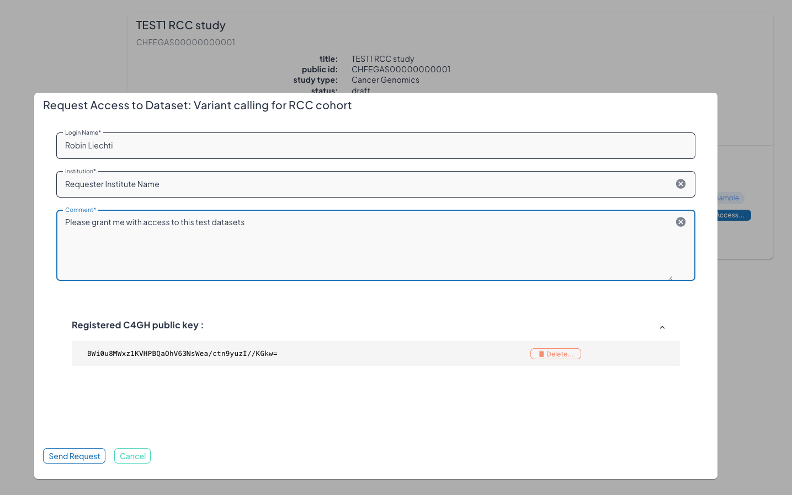
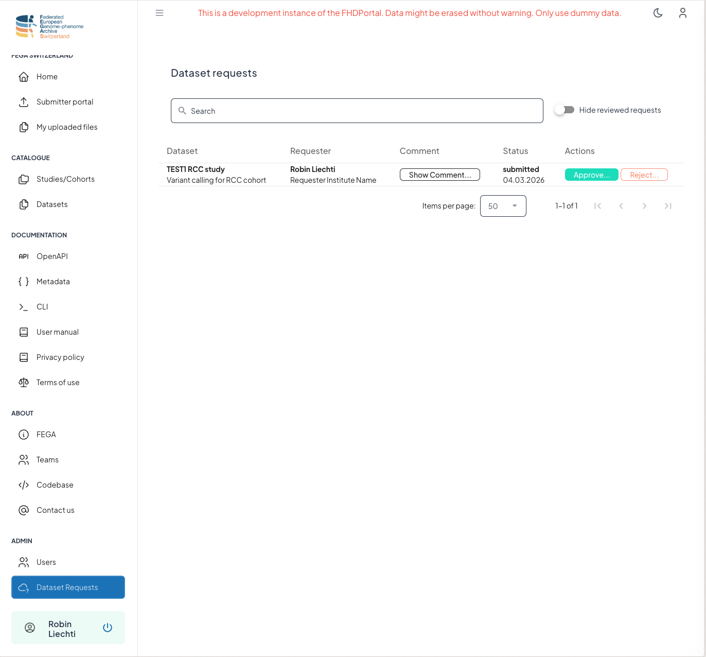

# FHDportal Docker Demonstrator

This standalone demonstrator application showcases the Federated Human Data (FHD) web portal for dataset submission to a Federated European Genome-Phenome Archive (FEGA) node. It was initially developed by the SIB Swiss Institute of Bioinformatics for the Swiss FEGA node.

***

## Prerequisites

- Docker and Docker Compose installed on your system
- Basic familiarity with Docker commands

***

## Getting Started

1. **Clone the repository:**

```bash
git clone git@github.com:rliechti/fhdportal-docker.git
cd fhdportal-docker
```

2. **Build and start the Docker containers:**
To run in the foreground:

```bash
docker-compose up --build
```

To run in the background (detached mode):

```bash
docker-compose up --build -d
```

3. **Open the portal in your browser:**
[http://localhost:5173](http://localhost:5173)

> **Installing on a server instead of a laptop?** Set the name under which it is reached, and use HTTPS:
> `scripts/set-public-host.sh fhd-demo.example.org --https`, then `docker compose up -d --build` (a self-signed
> certificate is made on the first start; put your own in `certs/` before it for a trusted one). All addresses derive from the `PUBLIC_*` lines at the top of `.env`. See
> [docs/install-on-a-server.md](docs/install-on-a-server.md). The other guides in [docs/](docs/README.md) describe the
> integration of a DAC portal, a secure data archive and an identity provider.

***

## User Tutorial

### Register and Setup Roles

1. Navigate to the **Submitter Portal**.
2. Click the **Register** link at the bottom of the page.
3. Complete the registration form. (You may leave `SSH Public Key` and `C4GH Public Key` empty initially.)
4. After registering, request the **Submitter Role** by clicking the corresponding button. A green confirmation message will appear.
5. *(In production mode)* This request sends an email to the FEGA helpdesk. This demonstrator uses [MailHog](http://localhost:8025) as a fake mail server for testing. Check the inbox at [http://localhost:8025](http://localhost:8025).

### Admin Setup for Role Management

6. A **fega-admin** account must exist to manage roles. For initial setup, use the Keycloak admin interface:
    - Access Keycloak at [http://localhost:8080](http://localhost:8080)
    - Log in with default credentials:
        - Username: `admin`
        - Password: `password`
7. In Keycloak:
    - Select **Manage Realms** then click on **fhdportal**.
    - Go to **Users** and select your username.
    - Go to **Role Mapping**, click **Assign Role** → **Realm Roles**, choose **admin-fega**, and click **Assign**.
8. Return to the FHDportal ([http://localhost:5173](http://localhost:5173)) and reload the page.
9. You should now see an **Admin** → **Users** menu. Use it to toggle the **Submitter** role for your user. 

### SSH Key Registration

10. Return to the **Submitter Portal** and reload the page.
11. Register your SSH public key. (*Note: SSH keys are not used in this demonstrator but are required in production for Secure Data Archive authentication.*)
12. Reload the page to reveal the submission button.
13. Click **Submit a New Study** to start your dataset submission.

***

## Importing Encrypted Files into Secure Data Archive (SDA-Inbox)

14. In this demonstrator, encrypted files (*.c4gh) must be manually copied into subdirectories within the `sda-inbox` directory.

15. Create an inbox directory named after your registered email:

```bash
cd sda-inbox
mkdir your.email@example.com
```

16. Copy or move your `*.c4gh` files into this inbox:

```bash
cd your.email@example.com
cp ../../fhdportal-example/RCC/files/*.c4gh .
```

17. A cron job running every minute scans these directories and updates the FHDportal database accordingly. **Wait one minute before proceeding.**

***

## Batch Submission Process

15. Click on **Large Submissions in Batch**.
16. Upload the example bundle `RCC.zip`.
17. After validation, click **Close**.
18. Explore your submission across the tabs: **Study, Samples, Experiments, Runs, Analyses, Datasets**.

***

## Completing the Submission

19. On the **Datasets** tab, associate a **Policy** for each dataset:
    - Click the **POLICY** button.
    - Select **Standard Data Access Policy** and click **Set Policy**.
    *(Note: In FEGA production, a separate DAC portal handles Policies. Here, a fake REST API serves this function.)*
20. Once policies are set for all datasets, a **Submit Study...** button will appear.
21. Click it to submit and confirm your study.
22. Within one minute the submitted datasets (and the study) become **approved**: a cron job plays the DAC portal here, by making the call a real DAC portal makes (`PATCH /api/submissions/{study}/datasets/{dataset}` with a `dac-cli` token). The help desk receives the usual "approved by DAC" mail in MailHog. In production the DAC portal approves.
23. Publication is done by an FHDportal administrator (role `admin-fega`, see the first steps). Open **Admin → Dataset Reviews** ("Dataset Publication Review"), click **approve...** on each dataset and then **confirm publication**.
24. Reload the page; the dataset status should update to **published**.

***

## Viewing Submissions

25. Go to **Catalogue** → **Studies/Cohorts** to find your submission listed.
26. Click your submission to view detailed information.

## Access request

While ideally, the access request is managed by a Data Access Committee portal, a minimal access request is available as a demonstrator.

27. Click on **Request Access...** 
    

28. Fill in the form. Provide a C4GH public key. It will be stored in the Keycloak account of the user, not in this form. Click on **Send Request**
    
29. An email in sent to a DAC email address. Navigate to http://localhost:8025
    
30. As administrator of FHDportal, click on **ADMIN -> Dataset Requests** at the bottom of the left navigation menu. All requests are listed here, showing their current status.

    *(Note: request approval/rejection is no longer performed from this admin page. In production, the real DAC portal reviews and approves/rejects requests itself, by calling back into FHDportal with its own service credential. This demonstrator's `dac-api` container is a stateless mock of that external DAC portal — it returns canned sample responses so the submission/request-creation flow can be exercised end-to-end, but it does not call back to approve anything, so requests here will stay in a "submitted" state rather than transitioning to "approved". To try that endpoint directly, obtain a token for the `dac-cli` Keycloak client via a client-credentials grant and call `PATCH /api/requests/{id}` with `{"request_status": "APR"}`.)*
    
