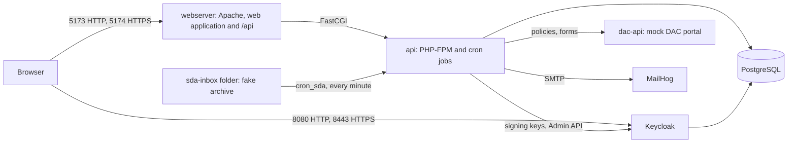
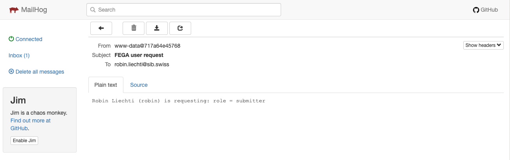
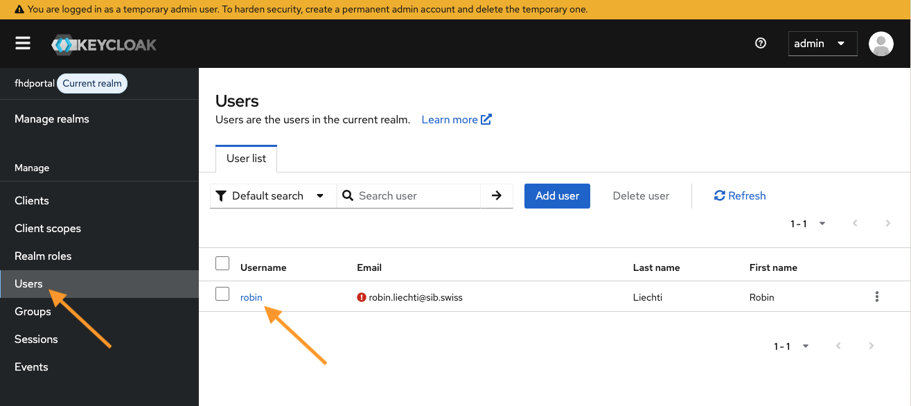
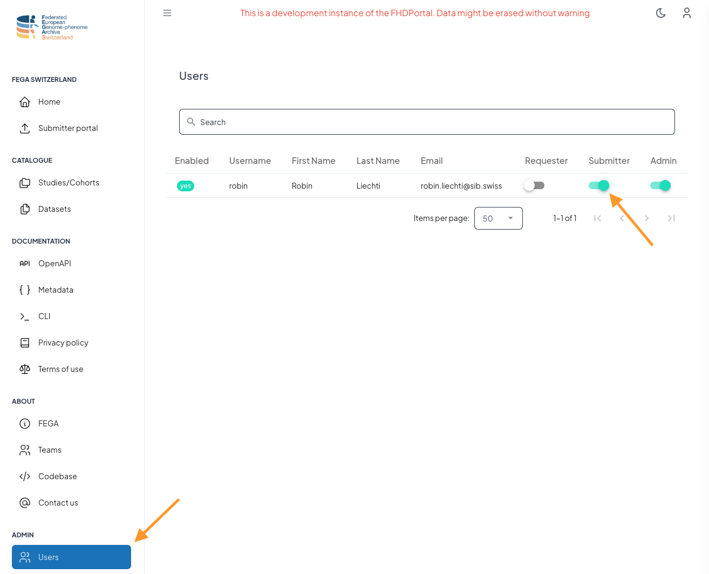
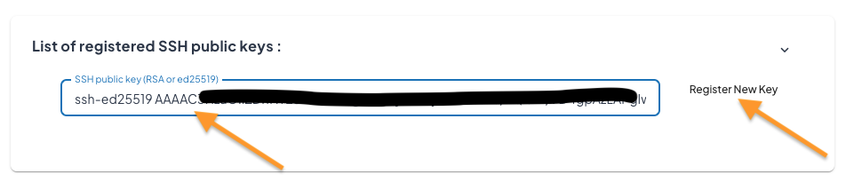
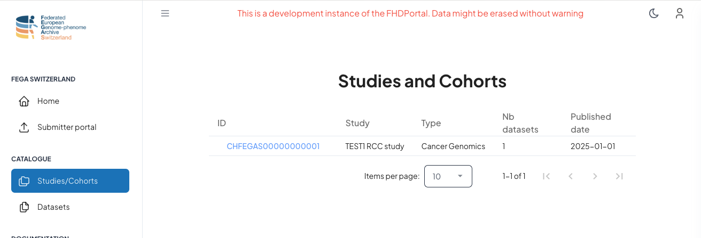
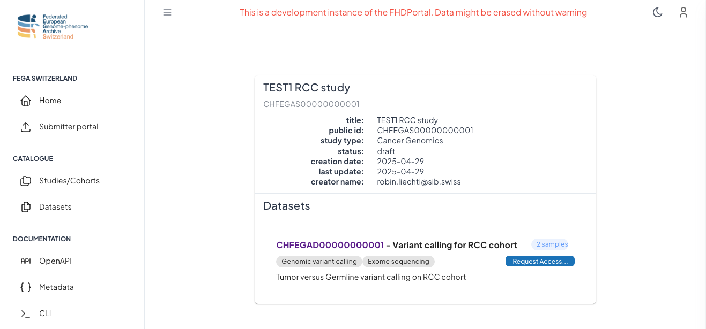
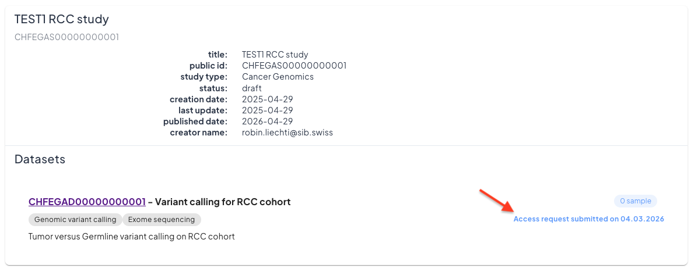
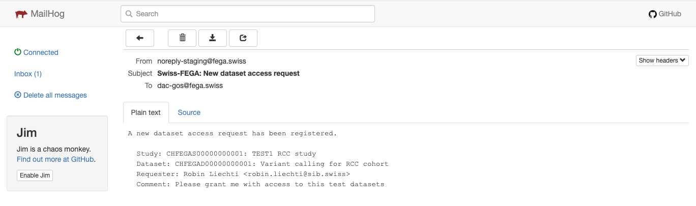

# FHDportal Docker Demonstrator

This standalone demonstrator showcases the Federated Human Data (FHD) web portal for dataset submission to a Federated European
Genome-phenome Archive (FEGA) node. It was initially developed by the SIB Swiss Institute of Bioinformatics for the Swiss FEGA
node. It runs the whole workflow on one machine: registration, submission of metadata, approval, publication, discovery
(catalogue and Beacon) and access requests.

> **A demonstrator, not a deployment.** It ships with a Keycloak administrator `admin` / `password`, client secrets in `.env`
> and in the realm file, open registration, and a self-signed certificate; data may be erased at any time. Use dummy data only.
> Before real people use it, read [Installing on a server](docs/install-on-a-server.md) and the hardening table of the
> [identity provider guide](docs/integration-identity-provider.md#7-hardening-the-demo-realm-before-production).

**Contents:** [What is real, what is simulated](#what-is-real-what-is-simulated) ·
[Quick start](#quick-start) · [Tutorial](#tutorial) · [Operating it](#operating-it) · [Testing it](#testing-it) ·
[Integration guides](#integration-guides) · [Limits](#limits-of-the-demonstrator)

***

## What is real, what is simulated



| Part | In this demonstrator | In production |
|---|---|---|
| Web application, API, metadata database, catalogue, Beacon | **real** | the same |
| Identity provider | **real Keycloak**, one realm, no upstream provider | Keycloak brokering to the national AAI |
| Secure Data Archive (SDA) | **a folder**, `sda-inbox/<e-mail>/`, scanned by a cron job every minute; no verification, no archiving | an archive with an SFTP/S3 inbox and a message broker |
| DAC portal | **a mock** (`dac-api`) that serves a policy and a form; a **cron job approves** submitted datasets by calling the API as the DAC would; **you** decide access requests with `scripts/dac-decision.sh` | a DAC portal such as REMS |
| Message broker (RabbitMQ) | **off**: no accession numbers, no download credentials | on |
| E-mail | MailHog, which keeps every mail | SMTP |

Consequence: you can submit, approve, publish, search and request access, but **not download data**.

***

## Quick start

**You need:** Docker with the Compose plugin (`docker compose`, v2); internet access during the first build (the API and the web
application are cloned from GitHub and built); a few GB of disk; these ports free: `5173`, `5174`, `8080`, `8443`, `8025`, `1025`,
`3000`, `5433`, `8082`. Optional, for the [end-to-end test](#testing-it): Node 20+, and `fega-cli`.

```bash
git clone https://github.com/sib-swiss/fhdportal-docker.git
cd fhdportal-docker
docker compose up --build -d      # the first build takes several minutes
```

Keycloak needs about a minute after the containers are up. Then open the portal:

| What | Address (laptop) |
|---|---|
| **Portal** | http://localhost:5173 (HTTPS on `https://localhost:5174`, self-signed: your browser will warn) |
| API, and its OpenAPI documentation | http://localhost:5173/api, and the menu entry *OpenAPI* |
| Beacon | http://localhost:5173/api/beacon/info |
| Keycloak (administrator `admin` / `password`) | http://localhost:8080 |
| MailHog, every mail of the system | http://localhost:8025 |
| Mock DAC portal | http://localhost:3000 |
| Database | `localhost:5433` (user and database in `.env`) |

The database, API, mock DAC and MailHog listen on this machine only. To run it on a server that other people reach, see
[Installing on a server](docs/install-on-a-server.md): set the name and use HTTPS with one command,
`scripts/set-public-host.sh fhd-demo.example.org --https`.

***

## Tutorial

The steps are numbered once, from 1 to 27. In *Part 1* you play a submitter, in *Part 2* the DAC and the help desk, in *Part 3*
a researcher who asks for access. Use one browser profile for the whole tutorial.

<!-- TODO screenshot: 26-keycloak-login.png (the Keycloak login page) -->

### Part 1: the submitter

#### Register and set up roles

1. Open the **Submitter portal** from the menu. The portal sends you to the Keycloak login page.
   
2. Click the **Register** link at the bottom of the login page.
   
3. Complete the registration form. (Leave `SSH Public Key` and `C4GH Public Key` empty for now.)
   
4. After registering, request the **Submitter Role** with the corresponding button. A green confirmation message appears.
5. In production this request sends an e-mail to the FEGA help desk. Here [MailHog](http://localhost:8025) keeps it: open it to
   see the mail.
   

#### Make yourself administrator (once)

6. Someone has to be the help desk (role `admin-fega`) to grant roles. For the first one, use the helper with the user name you
   registered:

   ```bash
   scripts/make-admin.sh your-username
   ```

   <details><summary>The same in the Keycloak console</summary>

   Open Keycloak at [http://localhost:8080](http://localhost:8080), log in as `admin` / `password`, select **Manage realms**, then
   **fhdportal**. Go to **Users**, select your user, then **Role mapping** → **Assign role** → **Realm roles**, choose
   **admin-fega** and click **Assign**.

   
   
   
   </details>

7. Reload the portal (log in again if asked). A new **Admin** → **Users** menu appears. Use it to toggle the **Submitter** role for
   your user.
   

#### Register your keys

8. Return to the **Submitter portal** and reload. Register your SSH public key. (SSH keys are not used by this demonstrator but
   are required in production, to authenticate to the SFTP inbox of the Secure Data Archive.)
   
9. Reload the page to reveal the submission button, and click **Submit a New Study**.
   You will need a Crypt4GH key later, to request access (step 23).

<!-- TODO screenshot: 27-submitter-portal-ready.png (the Submitter portal with "Submit a New Study", after role and keys) -->

#### Put the encrypted files in your inbox

In production you upload your encrypted files (`*.c4gh`) to the SFTP inbox of the archive. Here the inbox is a **folder**,
`sda-inbox/<your e-mail>/`, and a cron job registers what it finds there.

10. Make a test submission: a metadata bundle and the matching data files in one command. Use the e-mail address with which you
    registered: the files belong to that user.

    ```bash
    scripts/make-test-bundle.sh your.email@example.org
    ```

    It writes `bundles/<name>/<name>.zip` (the metadata, to upload in step 12) and the data files into
    `sda-inbox/your.email@example.org/` (random bytes under the right names, which is all the fake archive checks). The generator is
    the one of the end-to-end test; `-p 5 -c lung` makes a bigger lung-cancer study. To use files of your own, put your `*.c4gh`
    files in that folder (`mkdir -p sda-inbox/your.email@example.org`).

    > The folder must be named exactly like your registered e-mail address, and you must have used the portal once before
    > (steps 1 to 9 did that), otherwise a second user with the same address is created.

11. A cron job scans the inbox every minute. **Wait one minute**, or run it now:

    ```bash
    docker compose exec api php /var/www/fhd-portal/htdocs/api/tools/cron_sda.php
    ```

    The files then appear under **My uploaded files** in the menu.

    <!-- TODO screenshot: 16-my-uploaded-files.png (My uploaded files, listing the dropped files) -->

#### Upload the metadata

12. Click **Large Submissions in Batch** and upload the bundle `bundles/<name>/<name>.zip`.
13. After the validation, click **Close**.
    
14. Explore your submission in the tabs **Study, Samples, Experiments, Runs, Analyses, Datasets**.

#### Complete the submission

15. On the **Datasets** tab, choose a **Policy** for each dataset: click the **POLICY** button, select **Standard Data Access
    Policy** and click **Set Policy**. (In production a separate DAC portal serves the policies; here the mock does.)

    <!-- TODO screenshot: 17-policy-dialog.png (the Policy dialog) -->

16. When every dataset has a policy, a **Submit Study…** button appears. Click it and confirm.

    <!-- TODO screenshot: 18-submit-study.png (the confirmation, and the status "submitted") -->

### Part 2: the DAC and the help desk

The study goes through these statuses:

| Status | Meaning | Who |
|---|---|---|
| `draft` | being edited | the submitter |
| `submitted` | waits for the DAC | the submitter submitted it |
| `approved` | the DAC accepted it, it waits for the help desk | the DAC (here: a cron job) |
| `published` | in the catalogue | the help desk |
| `revised` | sent back to the submitter | the DAC or the help desk |
| `rejected`, `deleted` | refused, removed | |

17. **The DAC approves.** Within one minute the submitted datasets, and the study, become **approved**: a cron job plays the DAC
    portal by making the call a real DAC portal makes (`PATCH /api/submissions/{study}/datasets/{dataset}` with a `dac-cli` token).
    To see it at once:

    ```bash
    docker compose exec api php /var/www/fhd-portal/htdocs/api/tools/cron_approve.php
    ```

    The help desk gets the usual "FEGA new submission approved by DAC" mail, in MailHog.

    <!-- TODO screenshot: 19-dataset-approved.png (a dataset with the status approved) -->

18. **The help desk publishes.** As an administrator, open **Admin** → **Dataset Reviews** ("Dataset Publication Review"), click
    **approve…** on each dataset, then **confirm publication**.

    <!-- TODO screenshot: 20-admin-dataset-reviews.png (Dataset Reviews, with "approve…" and "confirm publication") -->

19. Reload the page: the dataset status is **published**.

    <!-- TODO screenshot: 21-dataset-published.png (the published dataset and its catalogue entry) -->

### Part 3: the requester

20. Go to **Catalogue** → **Studies/Cohorts**: your submission is listed.
    
21. Click your submission to see its details.
    

While the access request would ideally be managed by a Data Access Committee portal, a minimal one is available as a demonstrator.

22. Click **Request Access…**.
    
23. Fill in the form. It asks for a **Crypt4GH public key**; it is stored in the Keycloak account of the user, not in the form.
    If you have no key pair yet (the portal's own guide, *Encryption with FEGA*, says the same):

    ```bash
    pip install crypt4gh
    crypt4gh-keygen --sk alice.sec --pk alice.pub     # alice.pub is the public key to paste; keep alice.sec secret
    ```

    Click **Send Request**.
    
24. A mail to a DAC address is sent: see it in [MailHog](http://localhost:8025).
    
25. As administrator, open **Admin** → **Dataset Requests** (bottom of the left menu). Every request is listed there with its
    status, **read-only**: an administrator cannot decide a request. Only the DAC can, with a call to
    `PATCH /api/requests/{id}` that carries the token of its own client, `dac-cli`.
26. **You are the DAC.** Find the request id and send the decision:

    ```bash
    scripts/dac-decision.sh --list                      # the requests, newest first, with their ids
    scripts/dac-decision.sh <request id> APR            # approve; REJ rejects, or revokes an approval
    ```

    Reload **Dataset Requests**: the status is **approved** (or **rejected**).

    <!-- TODO screenshot: 22-dataset-requests-approved.png (Dataset Requests, status approved) -->

27. On approval, production issues download credentials for the requester's Crypt4GH key, through the archive. The demonstrator
    has no archive and no broker, so **no credentials are issued here**: this is where the demonstration stops.

### Beacon

Published datasets are exposed through a GA4GH Beacon v2:

```bash
curl http://localhost:5173/api/beacon/info
curl http://localhost:5173/api/beacon/datasets
```

Beacon keeps its model of the published datasets for 5 minutes, so a newly published dataset may take that long to appear.

<!-- TODO screenshot: 23-beacon-datasets.png (the Beacon response) -->

***

## Operating it

**Look and restart**

```bash
docker compose ps                     # the services
docker compose logs -f api            # the API; the cron jobs write to logs/cron.log
docker compose stop                   # stop, keep the data
docker compose up -d                  # start again
```

**Run the cron jobs now** instead of waiting a minute:

```bash
docker compose exec api php /var/www/fhd-portal/htdocs/api/tools/cron_sda.php        # register the files of sda-inbox/
docker compose exec api php /var/www/fhd-portal/htdocs/api/tools/cron_approve.php    # approve the submitted datasets
```

**Reset everything.** This **loses all data**: the database (including the Keycloak realm and every user) and the inbox. The realm
is imported again at the next start.

```bash
docker compose down
rm -rf fhd-db-data sda-inbox          # with sudo on Linux: the database files belong to the container
docker compose up -d
```

**Update.** The images clone the API (`fhdportal-api`) and the web application (`fhdportal-app`) from GitHub **when they are built**.
`docker compose up --build` reuses its cache and does **not** fetch newer commits: rebuild without it.

```bash
git pull                                              # this repository
docker compose build --no-cache api webserver && docker compose up -d
```

In-place upgrades of an existing database are not supported by the demonstrator: if an update changes the database, the realm
or the schemas, reset (above). Keycloak reads `init/fhdportal-realm.json` **only into an empty database**.

**Pin a version.** By default `API_REF` and `APP_REF` in `.env` are `main`, the tip of the branch on the day of the build, so two
builds made on different days can differ. For a reproducible installation set a tag or a commit, and rebuild as above:

```bash
API_REF=<tag or commit>
APP_REF=<tag or commit>
```

`API_REPO` and `APP_REPO` name the GitHub repositories that are built.

**Where it is reached** (`localhost`, HTTP) comes from the `PUBLIC_*` lines at the top of `.env`; see
[Installing on a server](docs/install-on-a-server.md).

**Mails** go to MailHog. Expect: the role request (to the help desk), "FEGA new submission approved by DAC" (to the help desk,
when the cron job approves) and "New dataset access request" (to the DAC address). An empty inbox after the matching step
means that step did not happen.

### When something does not work

| Symptom | Likely cause | What to do |
|---|---|---|
| The browser warns about the certificate | you opened the HTTPS port (5174), or an installation that uses HTTPS: the certificate is self-signed | use http://localhost:5173, or accept it once; for a server see [Installing on a server](docs/install-on-a-server.md) |
| The login fails with *Invalid parameter: redirect_uri* | the address in `.env` changed but the realm was imported earlier | `scripts/update-realm-urls.sh` |
| Every API call answers 401 | the token's issuer, audience or client is not the one the API expects | `docs/check-token.sh <token>`; [the identity guide](docs/integration-identity-provider.md#54-troubleshooting-401) |
| My uploaded files stays empty | the inbox folder is not named exactly like your registered e-mail, the cron job has not run, or you had not used the portal yet | check the folder name; run `cron_sda.php`; read `logs/cron.log` |
| After *Submit*, nothing becomes approved | the cron job has not run yet, or the study has a dataset without a policy | wait a minute or run `cron_approve.php`; read `logs/cron.log` |
| A request never appears in *Dataset Requests* | the dataset is not published yet, its release date is in the future, or you have no Crypt4GH key | publish it (step 18), set the key (step 23) |
| A port is already in use | another program uses 5173, 5174, 8080, 8443 | stop it, or change the published ports in `compose.yml` |
| `git pull` and rebuild do not change anything | the images were built from cached layers | `docker compose build --no-cache api webserver` |

***

## Testing it

An API-level end-to-end test (Playwright, no browser, no human step) plays the whole path of this tutorial in about ten seconds:
accounts, bundle upload and editing, policy, submission, approval, publication, catalogue, Beacon and the access request with its
decision. It runs against this demonstrator and writes a report with its evidence.

```bash
cd e2e && npm install && cp .env.example .env && npm run e2e
```

See [e2e/README.md](e2e/README.md) for the scenario and what it covers.

<!-- TODO screenshot: 24-e2e-result.png (the end of `npm run e2e`, and a page of the generated report) -->

***

## Integration guides

Technical documentation, with examples that were run against this demonstrator, for the three systems that a node connects to
FHDportal, and for putting the demonstrator on a server. Start at [docs/README.md](docs/README.md).

| Guide | For |
|---|---|
| [DAC portal](docs/integration-dac-portal.md) | an adapter in front of REMS, SD Apply or another governance system |
| [Secure Data Archive](docs/integration-secure-data-archive.md) | an archive or storage service: the inbox, the messages, the download credentials |
| [Identity provider](docs/integration-identity-provider.md) | Keycloak and a national or institutional login |
| [Installing on a server](docs/install-on-a-server.md) | a virtual machine with a real name and HTTPS |

## Limits of the demonstrator

* The **archive is a folder**: files are listed by name, size and checksum, never read, verified or archived. Their status is
  *published* from the start. See the [archive guide](docs/integration-secure-data-archive.md).
* The **DAC portal is a mock**: it serves one policy and one form and never decides. A cron job approves datasets and you decide
  access requests by hand.
* **No message broker, no download.** Approving a request does not issue credentials.
* **One realm, no upstream identity provider**, open registration, a self-signed certificate, default passwords.
* Beacon refreshes every 5 minutes. The data model, the schemas and the validation are those of the real portal.
