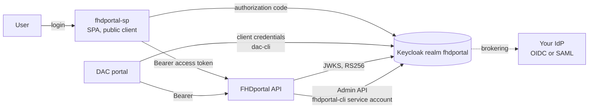

# Integrating an identity provider with FHDportal

Technical reference for the team that connects a national or institutional identity provider (Life Science AAI,
eduGAIN/Haka/SWITCH edu-ID, an LDAP or a university login) to FHDportal. It is written from `Keycloak.php` and
`KeycloakService.php` of the API and from the realm of the demonstrator (Keycloak 26.5). Examples marked *checked* were
run against this demonstrator.

Companion documents: [DAC portal](integration-dac-portal.md) · [secure data archive](integration-secure-data-archive.md).

---

## 1. Principle: Keycloak is the only identity provider the portal knows

FHDportal does not talk to your identity provider. It trusts **one Keycloak realm**: it validates the RS256 access tokens
of that realm, and it calls the Keycloak Admin API to read users and write roles and keys. Everything upstream (the
university, the AAI, a SAML federation) is Keycloak's business: **identity brokering** needs no change in FHDportal.



Consequences to plan for:

* **Another IdP in front of Keycloak is fine. A different product in place of Keycloak is not**, unless it also offers
  the Keycloak Admin API, because the portal uses that API (section 6).
* The DAC portal should use the **same realm** (see the [DAC guide](integration-dac-portal.md)).
* The realm shipped with the demonstrator declares **no identity provider** and no human user: both are yours to add.

## 2. The contract: what a token must contain

Every API call is checked, in this order, by `Keycloak::authenticate()`. A failed check makes the caller a *guest*, and
the endpoint answers **401 without saying why**.

| Check | Rule | Configured by |
|---|---|---|
| signature | RS256, key from `<KEYCLOAK_URL>/realms/<realm>/protocol/openid-connect/certs`; the key set is **cached for one hour** | `KEYCLOAK_URL` (internal address), `KEYCLOAK_REALM` |
| issuer | `iss` equals `<KEYCLOAK_ISSUER_URL>/realms/<realm>` exactly | `KEYCLOAK_ISSUER_URL` (falls back to `KEYCLOAK_URL`) |
| audience | `aud` contains `KEYCLOAK_EXPECTED_AUDIENCE` (default: `KEYCLOAK_CLIENT_ID`, `fhdportal-cli`) | realm: audience mapper |
| authorised party | `azp` is in the list (if the list is not empty) | `KEYCLOAK_ALLOWED_AZP` |
| identity | `sub` and `preferred_username` are strings | realm mappers |
| expiry | standard `exp`/`nbf` | realm token lifespan (300 s in the demo) |

Claims the portal then uses:

| Claim | Used for |
|---|---|
| `preferred_username` | **the stable key of a user** (`user.external_id`) |
| `email` | the address of the user: notifications, and the **name of the SDA inbox** |
| `name`, `given_name`, `family_name` | display name; also compared to the name typed in an access request |
| `sub` | Keycloak user id; checked on key registration; DAC member `userID` |
| `realm_access.roles` | authorisation: `submitter`, `admin-fega`, `dac-cli` |
| `c4gh-public-key`, `ssh-public-key` | the user's keys (multi-valued attributes, mapped to claims) |

A decoded user token of the demonstrator (*checked*):

```json
{ "iss": "https://0.0.0.0:8443/realms/fhdportal",
  "azp": "fhdportal-cli",
  "aud": ["fhdportal-cli", "account"],
  "sub": "6fe02c7b-9d5e-42ea-92d0-a86b1334a7e6",
  "preferred_username": "e2e-submitter",
  "email": "e2e-submitter@example.org",
  "name": "E2E Submitter",
  "realm_access": { "roles": ["submitter", "offline_access", "uma_authorization", "default-roles-fhdportal"] },
  "c4gh-public-key": ["jfSMojYv9w5LGZY/ozvFmJ6xi3jyOOX2KtuPtIr6hoA="] }
```

### 2.1 Roles

| Realm role | Grants | Given by |
|---|---|---|
| *(none)* | catalogue, own profile, access requests | automatic |
| `submitter` | create and edit studies and datasets | the help desk, on request |
| `admin-fega` | help desk: users and roles, dataset reviews, all requests | an administrator, in Keycloak (the first one, by hand) |
| `dac-cli` | the DAC portal's service account | the realm, on the `dac-cli` client |

`requester` and `dac-member` exist in the realm but the API does not test them.

### 2.2 Users are created at the first call

On the first request with a valid token the portal inserts a row for the user (`external_id` = `preferred_username`,
`email`, the claims above). On later requests it updates the row if the e-mail, the username or the claims changed. Service
accounts (`preferred_username` containing `service-account-`) get no row.

> **`preferred_username` must never change for a person.** If it does (another upstream provider, a reconfigured mapper),
> the portal creates a *new* user and the person loses access to their studies, which are owned by the old row.

## 3. Clients of the realm

| Client | Type | Flow | Role in the system |
|---|---|---|---|
| `fhdportal-sp` | public | authorization code | the web application (`VITE_KEYCLOAK_CLIENT_ID`); redirect URI `http://localhost:5173/*` |
| `fhdportal-cli` | confidential, service account | authorization code, password grant, client credentials | the API itself (`KEYCLOAK_CLIENT_ID` / `KEYCLOAK_SECRET`): its service account calls the Admin API; its name is the expected **audience**; command-line tools and the end-to-end test log users in through it |
| `dac-cli` | confidential, service account | client credentials | the DAC portal's decisions |

All three carry the audience mapper `fhdportal-api-audience` (adds `fhdportal-cli` to `aud`); `fhdportal-sp` and
`fhdportal-cli` also carry the two attribute mappers `c4gh-public-key` and `ssh-public-key`. The service accounts of
`fhdportal-cli` and `dac-cli` hold the `realm-management` roles `view-users`, `query-users`, `manage-users` and
`query-groups`.

Keycloak imports `init/fhdportal-realm.json` **only into an empty database**. For an existing deployment apply the same
changes through the Admin API or the console.

## 4. Federating an upstream identity provider

### 4.1 Recipe with the Admin API (*checked*: each call answered 201, the login page then offered the provider, and the
provider was removed again)

```bash
KC=https://0.0.0.0:8443
AT=$(curl -sk -X POST $KC/realms/master/protocol/openid-connect/token \
  -d grant_type=password -d client_id=admin-cli -d username=admin -d password=password \
  | python3 -c 'import sys,json; print(json.load(sys.stdin)["access_token"])')
H="Authorization: Bearer $AT"

# 1. the provider (OIDC here; use "saml" for a SAML federation)
curl -sk -X POST "$KC/admin/realms/fhdportal/identity-provider/instances" -H "$H" -H 'Content-Type: application/json' -d '{
  "alias": "upstream", "displayName": "Your institution", "providerId": "oidc",
  "enabled": true, "trustEmail": true, "firstBrokerLoginFlowAlias": "first broker login",
  "config": {
    "clientId": "<id registered at the provider>", "clientSecret": "<secret>", "clientAuthMethod": "client_secret_post",
    "authorizationUrl": "https://idp.example.org/oauth2/authorize",
    "tokenUrl": "https://idp.example.org/oauth2/token",
    "jwksUrl": "https://idp.example.org/oauth2/jwks", "useJwksUrl": "true", "validateSignature": "true",
    "userInfoUrl": "https://idp.example.org/oauth2/userinfo", "issuer": "https://idp.example.org",
    "defaultScope": "openid email profile", "syncMode": "FORCE" } }'

# 2. a username that is stable across logins and providers (see the box in 2.2)
curl -sk -X POST "$KC/admin/realms/fhdportal/identity-provider/instances/upstream/mappers" -H "$H" -H 'Content-Type: application/json' -d '{
  "name": "stable-username", "identityProviderAlias": "upstream",
  "identityProviderMapper": "oidc-username-idp-mapper",
  "config": { "syncMode": "FORCE", "template": "${CLAIM.sub}@upstream" } }'

# 3. optional: every user who comes through this provider is a submitter
curl -sk -X POST "$KC/admin/realms/fhdportal/identity-provider/instances/upstream/mappers" -H "$H" -H 'Content-Type: application/json' -d '{
  "name": "default-submitter", "identityProviderAlias": "upstream",
  "identityProviderMapper": "hardcoded-role-idp-mapper",
  "config": { "syncMode": "INHERIT", "role": "submitter" } }'
```

Register `https://<keycloak>/realms/fhdportal/broker/upstream/endpoint` as the redirect URI at the provider.

### 4.2 Checklist for a federated setup

- [ ] **`preferred_username` is stable** and unique per person: derive it from an immutable upstream identifier
      (`sub`, `eduPersonUniqueId`, ORCID), not from a display name or a mail address that changes.
- [ ] **`email` is always present.** The portal reads `$user['email']` for every non-service token; a provider that does
      not release it must be completed by the first-login flow (*Review profile*, or a mapper).
- [ ] `trustEmail` is true only if the provider verifies addresses. The inbox of the archive is named after this address.
- [ ] The **audience** (`fhdportal-cli`) is in the token of every client that calls the API: the mapper is on the client,
      not on the provider, so a new client needs it too. A client with a new name also goes into `KEYCLOAK_ALLOWED_AZP`.
- [ ] The key mappers (`c4gh-public-key`, `ssh-public-key`) are on every client whose tokens reach the API.
- [ ] A login through a different provider for the same person lands on the same account (account linking on the
      matching e-mail, or a shared `preferred_username` template).
- [ ] The help desk knows that new users have no role until they ask (or the hard-coded mapper above gives one).
- [ ] The EGA credential question is a Central EGA matter: say in your deployment documentation which operations need only
      a local identity (browsing, requesting) and which need an EGA account.

## 5. Calling the API: tokens and examples

### 5.1 A user token (*checked*)

For a human the portal uses the authorization-code flow. For scripts and tests, `fhdportal-cli` offers the password grant
(**switch it off in production**, section 7):

```bash
set -a; . ./.env; set +a
USER_TOKEN=$(curl -sk -X POST "$KEYCLOAK_ISSUER_URL/realms/$KEYCLOAK_REALM/protocol/openid-connect/token" \
  -d grant_type=password -d client_id="$KEYCLOAK_CLIENT_ID" -d client_secret="$KEYCLOAK_SECRET" \
  -d username=e2e-submitter -d password='…' -d 'scope=openid profile roles' \
  | python3 -c 'import sys,json; print(json.load(sys.stdin)["access_token"])')

curl -sk http://localhost:5173/api/submissions -H "Authorization: Bearer $USER_TOKEN"
```

Request the token from `$KEYCLOAK_ISSUER_URL` (here `https://0.0.0.0:8443`): its host becomes the token's `iss`.

### 5.2 A service token

```bash
curl -sk -X POST "$KEYCLOAK_ISSUER_URL/realms/$KEYCLOAK_REALM/protocol/openid-connect/token" \
  -d grant_type=client_credentials -d client_id=dac-cli -d client_secret="$KEYCLOAK_DAC_SECRET"
```

### 5.3 Check a token before blaming the API (*checked*)

`docs/check-token.sh` decodes a token and compares it with the configuration in `.env`:

```bash
docs/check-token.sh "$USER_TOKEN"
```
```text
ok   iss equals https://0.0.0.0:8443/realms/fhdportal
ok   aud contains fhdportal-cli
ok   azp in fhdportal-sp,fhdportal-cli,dac-cli
ok   sub and preferred_username
ok   not expired
ok   email present (users only)
roles: ['submitter', 'offline_access', 'uma_authorization', 'default-roles-fhdportal']
```

For the same request sent to `https://localhost:8443` instead, the first line becomes
`FAIL iss equals https://0.0.0.0:8443/realms/fhdportal` (`got iss=https://localhost:8443/…`). The API's answer to that
token is a plain 401.

### 5.4 Troubleshooting 401

| Symptom | Likely cause | Fix |
|---|---|---|
| 401 on every call, token looks fine | `iss` differs from `KEYCLOAK_ISSUER_URL`: the token was requested at another host name (`localhost` for `0.0.0.0`, an internal for a public URL) | request the token at the issuer URL; set `KEYCLOAK_ISSUER_URL` to the **public** URL |
| 401, `aud` has no `fhdportal-cli` | audience mapper missing on that client | add `fhdportal-api-audience` to the client |
| 401, `azp` not listed | a new client | add it to `KEYCLOAK_ALLOWED_AZP` |
| 401 on the DAC calls only | `dac-cli` role missing, or `azp` is not `KEYCLOAK_DAC_CLIENT_ID` | role on the service account; use the `dac-cli` client |
| 401 for a user without `email` | the upstream provider does not release it | map or ask for the address |
| 401 right after Keycloak rotated its keys | the key set is cached for one hour | wait, or clear the API cache |
| user has lost their studies | `preferred_username` changed | restore it; see 2.2 |
| role granted but not effective | the token was issued before the grant | log in again (tokens live 300 s) |

## 6. What the API does to Keycloak

The API authenticates to the Admin API as the **service account of `fhdportal-cli`** (client credentials). Used for:

| Portal feature | Endpoint | Keycloak action |
|---|---|---|
| list users (administrators) | `GET /api/users`, `GET /api/admin/users` | read users |
| set roles | `PUT /api/admin/users/{keycloak user id}/roles`, body: the **complete** list of role names, e.g. `["submitter"]` | add missing roles, remove those not in the list |
| register or delete a key | `POST` / `DELETE /api/users/{sub}/public-key…` | write the user attributes `c4gh-public-key`, `ssh-public-key` |
| ask for a role | `POST /api/users/request` (multipart, with the signed DTPA) | the request reaches the help desk (README step 5); an administrator sets the role |

So the service account needs `view-users`, `query-users` and `manage-users`, and Keycloak's *user profile* must declare
the two attributes as editable (the realm does).

Example, as an administrator (user id from `GET /api/admin/users`):

```bash
curl -sk -X PUT "http://localhost:5173/api/admin/users/$KEYCLOAK_USER_ID/roles" \
  -H "Authorization: Bearer $ADMIN_TOKEN" -H 'Content-Type: application/json' -d '["submitter"]'
```

The **first administrator** has no one to promote them: assign `admin-fega` in the Keycloak console (README steps 6 and 7).

Setting up accounts for tests, as the end-to-end test does (Admin API): `POST /admin/realms/fhdportal/users`,
`PUT …/users/{id}/reset-password`, `POST …/users/{id}/role-mappings/realm` with the role representation.

## 7. Hardening the demo realm before production

The demonstrator realm favours convenience. Change at least:

| Setting (demo) | Production |
|---|---|
| `sslRequired: none`, HTTP on port 8080, self-signed certificate on 8443 | `external`/`all`, a real certificate, no plain port |
| `registrationAllowed: true` | off if an IdP supplies the accounts |
| `verifyEmail: false`, no brute-force protection | on |
| realm file and `.env` hold the client secrets and the admin password (`admin`/`password`) | secrets from a secret store, rotated; remove the committed ones |
| password grant on `fhdportal-cli` | off for users (keep client credentials for services) |
| `start-dev` | `start`, with the hostname and proxy settings (`KC_HOSTNAME`) |
| `fhdportal-cli` redirect URIs `/*`, web origins `/*` | the exact URLs |
| token lifespan 300 s | keep short; align the refresh settings with the SPA |
| `KEYCLOAK_ISSUER_URL=https://0.0.0.0:8443` | the **public** URL of the realm; `KEYCLOAK_URL` stays the internal address |

Deployments where the browser-facing URL differs from the in-cluster one (the normal Kubernetes case) must set
`KEYCLOAK_ISSUER_URL` to the public one; see `k8s_template/`.

## 8. Test recipe

1. Log in through the upstream provider in the web application: you land on the portal with no role.
2. Decode the token (`docs/check-token.sh`): `iss`, `aud`, `azp`, `email`, `preferred_username` are as in section 2.
3. Call `GET /api/submissions` with it: 200, and a row for the user exists (it is created at that first call).
4. Log in again through the same provider and through another one for the same person: the same user, the same studies.
5. Ask for the `submitter` role, grant it in *Admin → Users*, log in again: `realm_access.roles` contains `submitter`.
6. Register a Crypt4GH key (`POST /api/users/{sub}/public-key`), log in again: the claim `c4gh-public-key` is present.
7. Run the scenario against the realm: `cd e2e && npm run e2e` creates its accounts with the Admin API
   (`E2E_MANAGE_ACCOUNTS=0` uses existing ones). Phase 0 of the report is the realm check: four tokens with the right
   roles and audience, the API accepting them, a key registered.
