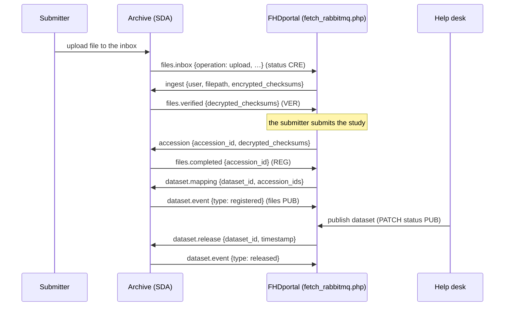

# Integrating a Secure Data Archive (SDA) with FHDportal

Technical reference for the team that connects an archive to FHDportal, for example the SDA of a Local EGA, a national
storage service or a Federated EGA node. It is written from the API code, from `init/cron_sda.php` and
`tools/fetch_rabbitmq.php`, and from the end-to-end scenario in [`../e2e`](../e2e/README.md). The examples marked *checked*
were run against this demonstrator.

Companion documents: [DAC portal](integration-dac-portal.md) · [identity provider](integration-identity-provider.md).

---

## 1. What the archive is for, and what FHDportal expects from it

FHDportal handles **metadata and governance**. It never stores or reads the data files. The archive does, and FHDportal
needs four things from it:

| Need | What it means | Demonstrator | Production (Local EGA style) |
|---|---|---|---|
| **Inbox** | the submitter drops encrypted files (Crypt4GH, `.c4gh`) where only they can write | a folder per e-mail address | SFTP/S3 inbox, authenticated with the user's key |
| **File events** | FHDportal learns that a file arrived, was renamed, removed, verified or rejected | `cron_sda.php` scans the folder every minute | messages `files.inbox`, `files.verified`, `files.completed`, `files.error` |
| **Accession and release** | files get an accession id; a dataset groups them; the help desk releases it | not simulated | messages `accession`, `dataset.mapping`, `dataset.release`, `dataset.event` |
| **Download** | an approved requester receives time-limited credentials for the files | not simulated | messages `swiss_download.*` and the Data Out API (DOA) |

The first two are enough to run the submission workflow, which is all the demonstrator does. The last two are needed for
a node that serves data.

## 2. Integration profiles

| Profile | Transport | What you build | When |
|---|---|---|---|
| **A. No broker** (the demonstrator) | a directory scan | replace the scan in `cron_sda.php` by your archive's notification | a node without a message broker, or a pilot |
| **B. Message broker** | RabbitMQ topic exchange (Central/Local EGA style) | a bridge from your archive to the queues of section 5 | the production path |
| **C. Different broker** | Kafka, NATS, a cloud queue | one class implementing `RabbitMqInterface` plus a consumer | a node whose broker is not RabbitMQ |

Outbound messaging sits behind `App\Service\RabbitMq\RabbitMqInterface` (six methods; `sendMessage()` carries the five
messages). `RABBITMQ_ENABLED=false` selects `NullRabbitMq`, which accepts every call and does nothing: no connection is
attempted.

**There is no REST endpoint that registers, verifies or publishes a file.** A bridge written against the REST API can
drive the governance path ([DAC guide](integration-dac-portal.md)), not the file lifecycle (MS5.3 §5.2, requirement R-49).
Profile B or C is the way until such endpoints exist.

## 3. Identity, keys and file ownership

* A file belongs to the portal user whose **e-mail address** is named by the inbox (`e-mail` of the user in Keycloak). The
  portal creates the user on their first authenticated call (see the [identity guide](integration-identity-provider.md));
  in the demonstrator, make one API call as the user **before** you drop files, or the cron job creates a second user with
  the same address (e2e step 0.2).
* Each user registers a **Crypt4GH public key**, used to re-encrypt the data for them at download, and an **SSH key** for
  SFTP inboxes. Both are kept as Keycloak user attributes (`c4gh-public-key`, `ssh-public-key`, multi-valued) and travel in
  the token as claims of the same names.

### 3.1 Register a key (checked)

`POST /api/users/{user_sub}/public-key`, where `{user_sub}` is the `sub` claim of the caller's token (any other value gives
`401 {"message":"User mismatch"}`).

```bash
curl -sk -X POST "$API/users/$SUB/public-key" \
  -H "Authorization: Bearer $USER_TOKEN" -H 'Content-Type: application/json' \
  -d '{"params":{"type":"c4gh","userKey":"-----BEGIN CRYPT4GH PUBLIC KEY-----\njfSMojYv9w5LGZY/ozvFmJ6xi3jyOOX2KtuPtIr6hoA=\n-----END CRYPT4GH PUBLIC KEY-----\n"}}'
```

| Case | Answer |
|---|---|
| accepted | `200`; the key is added to the Keycloak attribute, logged by SHA-256, and a mail is sent to the user |
| the key is already registered | `400 "Public key is already associated to the user"` |
| `userKey` shorter than 10 characters | `422 {"message":"Validation failed", …}` |
| `c4gh` key of fewer than 64 characters *as sent* | `400 "The provided key is probably invalid (too short)"`: send the **armoured** form, with the `BEGIN`/`END CRYPT4GH PUBLIC KEY` lines, not the bare base64 |
| `c4gh` key whose base64 is not 32 bytes | `400 "Error: Invalid C4GH key"` |
| `ssh` key rejected by `ssh-keygen -l` | `400 "The provided key is not valid"` |

`DELETE /api/users/{user_sub}/public-key/{key_type}/{public_key}` removes one.
The key is a claim of the *next* token: the user's current one does not carry it, so they log in again (or refresh).

## 4. Profile A: the folder contract of the demonstrator

### 4.1 Layout

```
sda-inbox/                       ← mounted in the API container as /var/www/fhd-portal/sda  (SDA_INBOX)
└── e2e-submitter@example.org/   ← one directory per user, named by the user's e-mail address (must contain "@")
    ├── .filelist                ← written by the cron job: "name:sha256" per line, its memory of the last scan
    ├── DEMO-…-GERMLINE-DNA-01.1.fastq.gz.c4gh
    └── …
```

Rules of `init/cron_sda.php`, run every minute from `init/sdacron`:

* only files ending in **`.c4gh`** (case-insensitive) count; names beginning with `.` are ignored;
* the identity of a file is its **SHA-256**: that is what tells a *new* file from a *renamed* one;
* the three operations are derived from the difference to `.filelist`.

| You do | The cron job sees | In the portal |
|---|---|---|
| copy a new `.c4gh` | `upload` (new checksum) | a file resource is created, with an accession `CHFEGAF…`, history `CRE` |
| `mv a.c4gh b.c4gh` | `rename` (known checksum, new name) | same file and accession, new `filepath`, history `MOD` |
| `rm a.c4gh` | `remove` (listed before, gone now) | status `DEL`, history `DEL`, comment `deleted by user` |

*Checked*, with a 2 kB file, one cron run after each step (`docker compose exec api php /var/www/fhd-portal/htdocs/api/tools/cron_sda.php`):

```text
upload  →  docs-demo-sample.c4gh  PUB  CHFEGAF00000000733  [CRE]
rename  →  docs-demo-sample.c4gh  PUB  CHFEGAF00000000733  [CRE, MOD]      (title unchanged, filepath updated)
remove  →  docs-demo-sample.c4gh  DEL  CHFEGAF00000000733  [CRE, MOD, DEL]
```

The cron job writes its message for each change in the format of the `files.inbox` message (section 5.2), so the logic
that you replace is exactly "turn your archive's notification into these three operations".

### 4.2 What the cron job stores

For an `upload` it validates and inserts a resource of type `SdaFile`:

```json
{ "title": "sample-1.fastq.gz.c4gh",
  "filepath": "var/www/fhd-portal/sda/e2e-submitter@example.org/sample-1.fastq.gz.c4gh",
  "filesize": 1105,
  "file_last_modified": 1795016532,
  "encrypted_checksums": [ { "type": "sha256", "value": "6c3a…" } ] }
```

Required: `title`, `filepath`, `filesize`, `file_last_modified`, `encrypted_checksums`. The portal adds `public_id`
(`^CHFEGAF[0-9]{11}`). The owner is the user of the folder (role `owner`).

**The demonstrator shortcut**: the cron job writes the file with status **`PUB`** ("published") at once. A real archive
goes through `CRE → VER → REG → PUB` (section 5.3); nothing here verifies or archives the file.

### 4.3 Seeing it from the API (checked)

`GET /api/files?page=1&by=200&search=<text>` lists the caller's files:

```json
{ "data": [ { "resource_id": "0002910a-…", "status": "PUB",
              "name": "DEMO-E2E-261118-123015-1942-GERMLINE-DNA-01.2.fastq.gz.c4gh",
              "filesize": "1105", "public_id": "CHFEGAF00000000093",
              "datasets": [ { "public_id": "CHFEGAD00000000008", "status_type_id": "DRA", "study_public_id": "CHFEGAS00000000004" } ],
              "history": [ { "action_type_id": "CRE", "action_time": "2026-11-18 11:30:16.007641" } ] } ] }
```

Other views: `GET /api/submissions/{study}/raw-files` and `/analysis-files` (files of one study),
`GET /api/datasets/{dataset_public_id}` (a published dataset lists its files). The cron output is in `logs/cron.log`.

### 4.4 Recipe: put data into the demonstrator

```bash
mkdir -p sda-inbox/you@example.org
cp ../fhdportal-example/RCC/files/*.c4gh sda-inbox/you@example.org/
docker compose exec api php /var/www/fhd-portal/htdocs/api/tools/cron_sda.php     # or wait one minute
```

A complete, validated bundle with matching files is produced by the generator of the test
(`e2e/create_test_bundle.php`; `npm run e2e` calls it and drops the files, steps 1.1 to 1.3).
The metadata of a bundle refers to the files **by name**; the scenario lists the files first (phase 2) and uploads the
bundle afterwards (phase 3), and the README tutorial does the same.

## 5. Profile B: the message contract

Enable with `RABBITMQ_ENABLED=true` and the `MQ_*` variables of `.env`:

| Variable | Demonstrator value | Meaning |
|---|---|---|
| `RABBITMQ_ENABLED` | `false` | `true` selects the real client |
| `MQ_HOST`, `MQ_PORT`, `MQ_VHOST` | `rabbitmq`, `5672`, `fega` | broker |
| `MQ_WRITER_USER`, `MQ_WRITER_PWD` | `fega`, `fega` | credentials of the portal |
| `MQ_EXCHANGE` | `fega` | the **topic** exchange; unrouted messages go to `localega.dead` |

Messages are JSON; `correlation_id` is a message property and **must be preserved by the archive on every reply**, because
the portal matches replies on it (a file's id is the one carried by its first `files.inbox` message).



### 5.1 Portal to archive

| Routing key | Sent when | Body |
|---|---|---|
| `ingest` | a `files.inbox` upload is received | `{"type":"ingest","user","filepath","encrypted_checksums":[…]}` |
| `accession` | the study is submitted, for each file of each dataset | `{"type":"accession","user","filepath","accession_id","decrypted_checksums":[…]}` |
| `dataset.mapping` | every file of a dataset is registered (`REG`) | `{"type":"mapping","dataset_id","accession_ids":[…]}` |
| `dataset.release` | the help desk sets a dataset to `PUB` (never for a non-published one: error 409) | `{"type":"release","dataset_id","user","timestamp"}` |
| `swiss_download.request` | a request becomes `APR` | `{"type":"swiss_download_request","dataset_name","user","user_c4gh_public_key"}` (armoured key) |
| `swiss_download.revoke.access` | an approved request is changed | `{"type":"swiss_revoke_download_access_request","user"}` |
| `swiss_download.token.request` | the requester asks for fresh credentials | `{"type":"swiss_refresh_download_token_request","user"}` |

`accession` and `dataset.mapping` identifiers are the portal's public ids (`CHFEGAF…`, `CHFEGAD…`). The three
`swiss_download.*` messages carry the **request id as `correlation_id`**.

### 5.2 Archive to portal

Each routing key has a durable queue with a dead-letter exchange. Run the consumer as a service:
`php tools/fetch_rabbitmq.php` (not started by the demonstrator).

| Routing key | Body (fields read) | Effect in the portal |
|---|---|---|
| `files.inbox` | `operation` (`upload` \| `rename` \| `remove`), `user` (e-mail), `filepath`; upload: `filesize`, `file_last_modified`, `encrypted_checksums:[{type,value}]`; rename: `oldpath` | create (`CRE`), rename (`MOD`) or delete (`DEL`) the file; an upload is forwarded as `ingest` |
| `files.verified` | `user`, `filepath`, `decrypted_checksums` | `VER`; the checksums are stored |
| `files.completed` | `user`, `filepath`, `accession_id` | `REG`, after checking that path and accession agree; when all files of a dataset are registered, `dataset.mapping` is sent |
| `files.error` | `filepath`, `user`, and `reason` or `error_message` | the file is set to `DEL` with the reason as comment, or an error resource is registered |
| `dataset.event` | `type`: `registered` (`dataset_id`, `accession_ids`), `released` (`dataset_id`), `deprecated` (`dataset_id`) | files `PUB`; dataset `PUB` (log `REL`); dataset `DEL` |
| `swiss.doa.operation.response` | the credential fields (below), `correlation_id` = request id | merged into the request; only for an `APR` request |
| `swiss.doa.error` | `errorType`, `errorMessage`, `timestamp`, `user`, `datasetName` | stored on the request (`error_type`, `error_message`) |

The consumer **ignores duplicates of `files.inbox`** (same encrypted checksum and correlation id). File statuses:

| Id | Name | Set by |
|---|---|---|
| `CRE` / `MOD` | created / modified | `files.inbox` |
| `VER` | verified | `files.verified` |
| `REG` | registered | `files.completed` |
| `PUB` | published | `dataset.event` `registered` |
| `DEL` | deleted | `remove`, `files.error`, `deprecated` |

### 5.3 Download credentials

On `APR` the portal asks the archive for credentials; the archive answers on `swiss.doa.operation.response`; the portal
keeps the fields and serves them to the requester:

```bash
curl -sk "$API/requests/$REQUEST_ID/tokens" -H "Authorization: Bearer $USER_TOKEN"
```

Fields kept on the request: `doa_endpoint`, `doa_bucket_name`, `doa_object_expiration`, `doa_access_key`, `doa_secret_key`,
`doa_session_token`, `doa_sts_token_expiration`. `GET /api/requests` lists the requests of the caller **without** the
secrets; only `…/tokens` returns them, and only for the owner of an `APR` request. It asks the archive for a fresh
session token (`swiss_download.token.request`) and waits a few polls for the new value.

*Checked*: for a request that is not approved the answer is `401 ["Unknown dataset download request"]`.

### 5.4 What happens with the broker off

`NullRabbitMq` makes every call succeed and does nothing, so in the demonstrator a request can reach `APR` (see the
[DAC guide](integration-dac-portal.md)) while **no credentials are issued**: the `doa_*` fields stay empty. This is the gap
to close when connecting an archive.

## 6. Testing an archive integration

| Step of the scenario | Checks |
|---|---|
| 1.3, 2.1 | files dropped in the inbox become listed in *My Uploaded Files* (`GET /api/files`) |
| 3.1 | the bundle, whose runs and analyses name the files, is uploaded after the files are listed |
| 4.3 | the submission sends the `accession` messages (profile B) |
| 5.x, 6.2 | publication; the dataset page lists its files |
| 7.5 to 7.7 | approval and revocation reach the archive (needs profile B) |
| 7.9 | **not tested**: the download itself (`test.fixme`, needs the broker and the DOA) |

Smoke test without the scenario:

1. Register a Crypt4GH key for a test user (section 3.1).
2. Upload a file as that user, check `GET /api/files` shows it with `CRE` (profile B) or `PUB` (profile A).
3. Send `files.verified` and `files.completed` by hand and watch the status move `VER`, `REG`.
4. Submit a study that uses the file and check the `accession` message arrives at the archive.

## 7. Open points for the final version

* Profile B is not part of the compose stack (no broker, no archive, `fetch_rabbitmq.php` not started). The message
  contract above is derived from the code; it has no automated test in this repository.
* The consumer's verbose logging is a constant set to `false` (the `MQ_VERBOSE` variable named in its comment is not read).
* `SubmissionService::handleSubmission` still guards the `accession` step on `MQ_HOST` being set, in addition to the
  `RabbitMqInterface`.
* The demonstrator's file status after the scan is `PUB`: do not read it as "archived".
